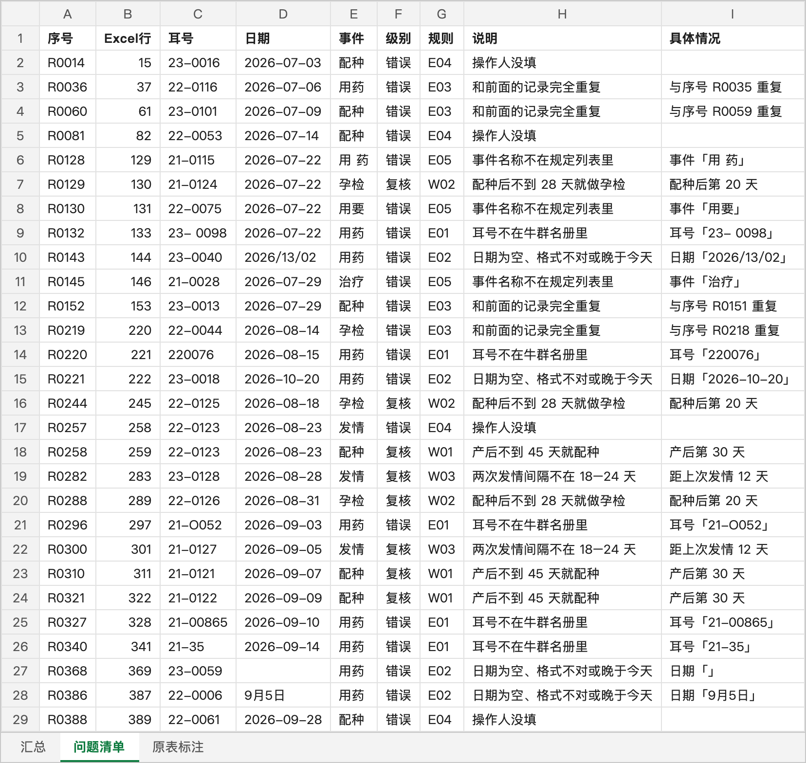

# Automatic check of farm breeding records (farm-data-check)

A demo project. It checks the breeding records that a cattle farm enters by hand each day (heat, breeding, pregnancy checks, calving, and medication) in one step. It finds records entered wrong and records that need a manual review.

**All data is simulated.** `make_demo_data.py` generates it at random. None of it comes from a real farm.

## What it finds

| Rule | Level | What it checks |
|---|---|---|
| E01 | 错误 (error) | The ear tag is not in the herd register (a missing 0, an extra digit, the letter O used as 0, a space in the middle) |
| E02 | 错误 (error) | The date is empty, has a bad format (for example month 13, or 「9月5日」), or is later than today |
| E03 | 错误 (error) | The same record was entered twice |
| E04 | 错误 (error) | The operator is empty |
| E05 | 错误 (error) | The event name is misspelled (for example 「用要」 or 「用 药」) |
| W01 | 复核 (review) | Breeding less than 45 days after calving |
| W02 | 复核 (review) | A pregnancy check less than 28 days after breeding |
| W03 | 复核 (review) | An interval between two heats outside 18–24 days |

The thresholds are at the top of `check.py`. Change them to match your farm's own standards.

## Usage

```bash
uv run make_demo_data.py                                   # 生成 demo/繁育记录-演示.xlsx
uv run check.py demo/繁育记录-演示.xlsx --today 2026-10-06  # 输出 …-核对结果.xlsx
uv run pytest -q                                           # 跑测试
```

The check result has three sheets. **汇总** shows how many issues each rule found. **问题清单** lists every issue. **原表标注** marks errors in red and records that need review in yellow.

The image below shows the **问题清单** sheet that the commands above produce (default seed 7): 403 records, 20 errors, and 8 records that need review.



## Input format

The input is one Excel file with two sheets:

- `繁育记录`: 序号, 日期, 耳号, 事件, 详情, 操作人
- `牛群名册`: 耳号, 出生日期, 胎次

## How the tests prove nothing is missed or wrong

When the generator creates data, it records every problem it plants on purpose (the "answers"). The tests require the check result to match the answers **exactly**. No planted problem may be missed, and no normal record may be flagged. The tests must pass with 5 different random seeds.
